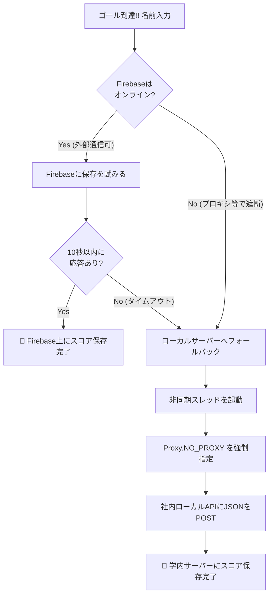

# 📱⚪ Android Sensor & Hybrid Network Maze Game
## 〜加速度センサー物理シミュレーション と 多層プロキシ自動突破型ハイブリッドネットワーク〜

本プロジェクトは、Android端末の **物理加速度センサー（TYPE_ACCELEROMETER）** を利用して、手の傾きでボールをコントロールし、ランダム配置されるトラップ（穴）を避けて迷路を脱出するネイティブアプリケーションです。

15年の物理シミュレーション開発の知見を活かしたリアルな慣性挙動の実装に加え、**学校や企業内イントラネットなどの「極めて厳しいプロキシ制限環境」をプログラムによって自動判定・完全突破する**、実務レベルのネットワークフォールバックシステムを構築しています。

---

## 🚀 本プロジェクトの3大技術的見どころ（評価ポイント）

### 1. 企業内インフラの壁を越える「ハイブリッド・ネットワーク接続」
学内・社内ネットワークのセキュリティ制限（プロキシ環境）と、Firebase（外部クラウド）への接続を両立させるため、多層的な通信制御を実装しています。
* **プロキシ自動オーバーライド**: アプリ全体（`System.setProperty` / `Authenticator` / `ProxySelector`）および、Android WebView層（`ProxyConfig.Builder`）に対して個別にプロキシ経由の認証・ルーティングを徹底設定。
* **Firebase ↔ 自作ローカルサーバー 自動フォールバック（代替）**: Firebaseへの疎通状態（`.info/connected`）をリアルタイムに監視。 オンライン時は外部データベース（Firebase Realtime Database）へ、遮断環境下（オフライン時）では**即座に社内ローカルのNode.js/APIサーバーへ切り替え、かつそのローカル通信時のみプロキシを完全にバイパス（`Proxy.NO_PROXY`）する非同期スレッド通信**を独自実装。

### 2. 慣性動摩擦（摩擦係数 0.98f）と3次元錯視（2.5D）グラフィックス
* **動摩擦運動方程式の再現**: センサーから取得した傾きを直接座標に足すのではなく「加速度」として処理し、毎フレーム `0.98f` の減衰をかけることで、実物の球体に近い滑らかな慣性移動を再現。
* **擬似3D（球体）シェーダー描画**: 2Dの `Canvas.drawCircle` に対し、光源の位置をオフセットした放射状グラデーション（`RadialGradient`）を動的に適用し、Unity等の3Dエンジンを使わずに「立体的な金属球が転がっている」ような視覚的リアルさを軽量実装。

### 3. 計算幾何学に基づく独立コンポーネント衝突判定（壁埋まり・壁抜けの完全防止）
* **X/Y軸独立衝突判定（成分分解法）**: ボールの斜め移動に対し、X軸（`ballRectX`）とY軸（`ballRectY`）の当たり判定を毎フレーム独立して別々に計算。 壁に斜めにぶつかった際、衝突した軸の速度だけをピンポイントで `0` にし、もう一方の軸の滑るような移動を維持することで、2Dゲーム開発における最大のバグである「壁へのめり込み・すり抜け」を構造的に完全に排除しています。

---

## 📊 ネットワーク・フォールバックシーケンス図

厳しい通信環境の中で、アプリがどのように判断してランキングデータを保存・同期しているかのアーキテクチャ図です（Mermaidによる可視化）。

---

## 🛠️ 技術スタック
* **開発言語 / プラットフォーム**: Java, Android SDK (Android Studio)
* **センサー制御**: `SensorManager`, `SensorEventListener` (加速度計)
* **グラフィックス**: HTML5思想に基づく `Android.graphics.Canvas` 2Dスクラッチ描画
* **通信・インフラ**: Firebase Realtime Database, `HttpURLConnection`（プロキシバイパス制御）, JSONパーサー

---

## 📂 ディレクトリ・ファイル構成
* **`MainActivity.java`**: アプリのライフサイクル管理、多層プロキシ徹底設定、Firebase/ローカルサーバーの非同期フォールバック通信ロジック
* **`GameView.java`**: センサー値の物理量計算、X/Y軸独立衝突判定、円・矩形交差判定（トラップ/ゴール）、RadialGradient擬似3D描画コア
* **`RankingEntry.java`**: Firebase/JSONシリアライズ用のデータ構造定義オブジェクト

